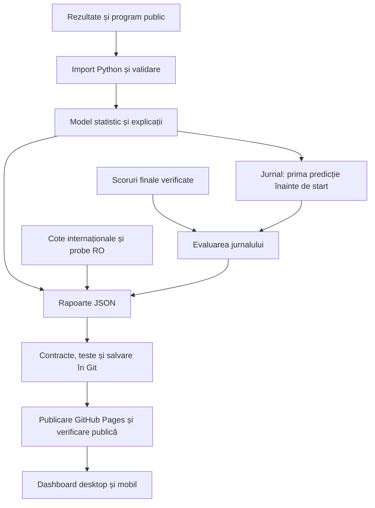

# ValueRadar — prezentare pentru un posibil asociat

**Sinteza proiectului și a sesiunii de lucru din 6–7 noiembrie 2026.**

Document pregătit pentru un cititor care nu a participat la discuții.
Separă funcțiile implementate, dovezile disponibile și dezvoltările propuse.
Indicatorii descriu fotografia din **7 noiembrie, 02:30 ora României
(00:30 UTC)**; aplicația continuă să se actualizeze automat.

**Aplicație:** https://alexpuiu06-ship-it.github.io/valueradar-app/

**Repository:** https://github.com/alexpuiu06-ship-it/valueradar-app

## 1. Ideea, în câteva minute

ValueRadar este o aplicație de analiză fotbalistică. Folosește rezultate și
statistici istorice pentru a estima probabilități, explică modul de calcul
și permite compararea lor cu cote. Direcția proiectului este să identifice
eventuale diferențe utile între model și piață, numai după verificarea datelor
și a performanței reale a modelului.

**Produsul există și este public.** Are analize pentru cinci ligi, comparație
manuală de cote, explicații, laborator de modele, jurnal de predicții,
monitorizare și actualizare automată. În sesiunea descrisă am auditat și
consolidat un proiect existent, apoi am integrat 12 loturi de modificări
prin pull request-uri separate, cu teste și publicare verificată.

**Validarea financiară nu este demonstrată.** Nu există un avantaj profitabil
confirmat, un feed complet verificat pentru operatorii români sau un ROI
demonstrat. Aplicația afișează explicit că nu există pariuri value verificate.
Nu plasează pariuri și nu promite predicții perfecte.

Diferența esențială pentru evaluarea proiectului: funcționarea software-ului
este testată; calitatea probabilităților și profitabilitatea necesită dovezi
statistice suplimentare. Patru meciuri evaluate prospectiv reprezintă un
început de măsurare, nu validarea unei strategii.

| Există și funcționează | Rămâne de demonstrat sau construit |
|---|---|
| Import, calcul statistic și explicații reproductibile | Avantaj prospectiv stabil față de repere potrivite |
| Interfață desktop/mobil și comparație manuală | Cote exacte RO, disponibile și suficient de proaspete |
| Cercetare Poisson/Elo/calibrare | Incertitudinea probabilității fiecărei partide |
| Jurnal protejat și evaluări pe rezultate observate | Eșantion prospectiv suficient și reprezentativ |
| Monitorizare gratuită și publicare verificată | Date/licențe potrivite pentru un produs comercial |

## 2. Domeniul produsului și experiența utilizatorului

Sunt urmărite Premier League, La Liga, Serie A, Bundesliga și Ligue 1.
Piețele sunt disponibile numai unde datele și pragurile de eșantion permit
o estimare; lipsurile sunt declarate.

| Piață | Ce încearcă să estimeze |
|---|---|
| 1X2 | Probabilitatea victoriei gazdelor, egalului și victoriei oaspeților |
| Goluri | Probabilitatea unui total peste/sub linia afișată |
| Galbene | Distribuția totalului de cartonașe galbene, când istoricul este suficient |
| Cornere | Distribuția totalului de cornere |
| Faulturi | Distribuția totalului de faulturi |

Ținta de acoperire locală este: **Superbet RO, Betano RO, Unibet RO, MrBit RO,
NetBet RO și Casa Pariurilor RO**. Aceasta este ținta de dezvoltare, nu o
declarație că toate sunt integrate și verificate astăzi.

Fluxul actual al utilizatorului:

1. Alege liga, meciul și piața; vede probabilitatea și starea datelor.
2. Deschide explicația: surse, eșantion, medii, formule, factori și limitări.
3. Poate introduce manual o cotă pentru evenimentul și selecția alese.
4. Primește o comparație matematică, etichetată ca analiză, fără recomandare
   de pariere confirmată.
5. Poate consulta modelele de cercetare, istoricul verificărilor RO și
   evaluarea predicțiilor arhivate.

O piață fără date suficiente, un meci început, o analiză expirată ori un
eșec de încărcare oprește comparația curentă. Nu completăm lipsurile cu zero
și nu presupunem că o cotă introdusă manual este o ofertă verificată la operator.

## 3. Cum circulă datele prin aplicație

Serverul de calcul este, în prezent, o execuție periodică Python în GitHub
Actions. Browserul afișează rapoarte JSON prin HTML și JavaScript, pe GitHub
Pages. Nu există un backend propriu permanent, conturi de operator sau un
sistem de executare a pariurilor. Registrul de date operaționale este păstrat
în fișiere versionate, nu într-o bază de date dedicată.

Codex a fost folosit pentru inginerie software, audit, implementare și teste.
Probabilitățile produsului sunt calculate de algoritmii statistici din cod;
nu sunt răspunsuri lingvistice generate de un chatbot.

| Componentă | Rol tehnic |
|---|---|
| Python 3.12 | Import, statistici, validare, cercetare și rapoarte; codul de producție folosește biblioteca standard |
| HTML/JavaScript | Filtre, explicații, comparație manuală, cercetare și monitorizare în browser |
| Git/GitHub | Istoric de cod/date, branch-uri separate și modificări verificabile prin PR |
| GitHub Actions | Testare, colectare periodică, calcul, verificare și publicare |
| GitHub Pages | Găzduirea interfeței și a rapoartelor publice |
| Playwright | Teste automate în Chromium desktop și mobil; Node.js 22 pentru instrumentele de test |
| GitHub Actions Secrets | Păstrarea cheilor API, în afara browserului și a repository-ului public |

## 4. Datele: ce avem și ce ne lipsește

| Sursă | Utilizare actuală | Limită importantă |
|---|---|---|
| OpenFootball football.json | Rezultate și goluri din sezoane istorice | Statisticile detaliate nu sunt disponibile uniform; pot exista întârzieri |
| open-matchday | Program și rezultate ale sezonului curent; galbene/cornere/faulturi unde sunt disponibile | Surse potențial întârziate/incomplete; utilizare necomercială declarată și drepturi ale surselor originale |
| The Odds API | Cote 1X2 UK/internaționale, folosite pentru diagnostic | Nu confirmă ofertele exacte ale celor șase case RO |
| PropLine | Monitorizare gratuită agregată Superbet RO/NetBet RO | Acoperire observată parțială și volatilă; prețurile nu sunt publicate ca oferte RO confirmate |
| OddsPapi | Probe de cote și verificarea unor scoruri la 90 minute | Cotele din eșantion nu au trecut toate cerințele; scorurile sunt folosite separat, numai la evaluare |

Fotografia de închidere are **3.935 meciuri istorice**, **197 analize viitoare**
și **20/20 resurse de intrare citite**. Cele 20 sunt fișiere/endpointuri din
două familii principale de surse, nu 20 furnizori independenți. O citire
reușită nu garantează corectitudinea fiecărui rând.

Importul verifică sezonul, data, tipurile numerice și identitatea echipelor.
Aliasurile sunt declarate explicit; nu folosim asemănarea aproximativă a
numelor ca dovadă că două meciuri sunt identice. Dublurile compatibile se
unesc, iar rezultatele contradictorii se izolează integral. Un rezultat
necunoscut nu devine un rezultat de 0–0.

Fiecare resursă are URL, moment de citire și amprentă SHA-256. Amprenta
identifică intrarea folosită, dar nu recuperează singură un fișier dispărut;
reproducerea identică cere și păstrarea intrărilor originale. Pentru program,
convenția sursei este UTC+01:00 fix; interfața convertește separat în UTC și
Europe/Bucharest, inclusiv schimbarea datei la miezul nopții.

## 5. Cum sunt estimate probabilitățile

### Modelul operațional

Modelul curent se numește `weighted_opponent_model_v1`. Pornește de la
statistici din aceeași ligă, anterioare meciului analizat, și calculează
producția echipei și ceea ce permite adversarul, separat acasă/deplasare.

Meciurile recente au pondere mai mare:

`w = 2^(-d / 185)`

`d` este vechimea în zile. După 185 zile, contribuția este înjumătățită.
Pentru eșantioane mici, media echipei este apropiată de media ligii:

`media_regularizată = (media_echipă × suma_ponderilor + 7 × media_ligii) / (suma_ponderilor + 7)`

Cele șapte pseudo-meciuri reduc oscilațiile unui istoric scurt. Suma
ponderilor nu reprezintă un număr garantat de observații independente și
nu justifică singură un interval de încredere.

Rata estimată pentru fiecare echipă combină producția proprie cu permisivitatea
adversarului prin media geometrică:

`lambda_gazde = sqrt(producție_gazde_regularizată × permis_de_oaspeți_regularizat)`

`lambda_oaspeți = sqrt(producție_oaspeți_regularizată × permis_de_gazde_regularizat)`

Ratele sunt apoi limitate operațional între 0,05 și 2,4 ori media ligii
pentru rolul de gazdă, respectiv oaspete.

Pentru totaluri se folosește Poisson sau binomială negativă, după dispersia
observată în ligă. Pentru 1X2 se combină două distribuții Poisson independente
ale golurilor. Independența este o simplificare, nu o proprietate demonstrată
a fiecărei partide.

Sunt cerute minimum 35 meciuri în ligă pentru majoritatea statisticilor,
70 pentru goluri și trei meciuri relevante pentru fiecare echipă. Acestea
sunt protecții inițiale de funcționare, nu praguri validate ca profitabile.
Arbitrii, accidentările, echipele de start și factorii tactici nu sunt incluși
în prezent. Lipsa lor este declarată, fără factori fabricați.

### Cercetarea: Poisson, Elo și calibrare

Elo urmărește forța relativă a echipelor și o actualizează după rezultate.
Varianta comparată include și egalul. Am evaluat și un amestec Poisson/Elo,
precum și ajustarea probabilităților prin temperatură:

`q = alpha × p_Poisson + (1 − alpha) × p_Elo`

`q_k = p_k^(1/T) / suma_j(p_j^(1/T))`

Selecția modelului și a ponderii se face pe validare; temperatura se ajustează
pe o perioadă ulterioară, separată. Evaluarea finală nu este folosită pentru
a modifica din nou parametrii. Actualizările Elo se fac după întregul grup
al zilei, pentru a evita folosirea rezultatelor din aceeași zi înaintea predicției.

Suportul comun este de **605 partide pentru validare, 400 pentru calibrare
și 693 pentru evaluarea finală**. Scoruri mai mici sunt mai bune:

| Model | Log-loss | Brier, media pe trei clase |
|---|---:|---:|
| Poisson operațional | 1,026404 | 0,205137 |
| Elo selectat pe validare | 1,000988 | 0,198642 |
| Poisson calibrat prin temperatură | 1,018566 | 0,203097 |
| Elo calibrat prin temperatură | 1,002184 | 0,199081 |
| Reper: frecvențele istorice ale ligii | 1,081505 | 0,218405 |

Log-loss penalizează predicțiile foarte sigure și greșite; Brier măsoară
eroarea pătratică a probabilităților. Calibrarea verifică dacă frecvențele
observate corespund, pe grupe, probabilităților estimate.

Elo a avut un scor mediu mai bun în această evaluare, însă intervalul
aproximativ de 95% al câștigului log-loss este **[−0,003717; +0,053414]**.
Include zero, deci superioritatea nu este concludentă. Incertitudinea a fost
estimată prin bootstrap pereche pe săptămâni ISO, cu seed fix; nici această
metodă nu elimină toate dependențele între echipe.

Amestecul selectat a dat greutate zero Poisson în acest experiment, deci
rezultatul lui coincide cu Elo. Nu este o confirmare independentă. Nici
calibrarea nu a îmbunătățit automat toate modelele. Istoricul fusese consultat
anterior: cercetarea este exploratorie, nu o probă prospectivă neatinsă.
**Modelul operațional nu a fost înlocuit automat.**

## 6. Cum sunt comparate probabilitățile cu cotele

Pentru o cotă zecimală `c`, probabilitatea implicată simplă este `1/c`.
Pentru o piață completă 1X2, probabilitățile pot fi normalizate prin suma
lor pentru un reper aproximativ fără marjă. Acesta nu este automat adevărul
despre probabilitatea evenimentului.

Calculul teoretic pentru o unitate mizată este:

`EV = probabilitate_estimată × cotă − 1`

Un EV pozitiv calculat nu dovedește un avantaj real. Poate rezulta dintr-un
model greșit, preț vechi, altă piață, altă perioadă sau reguli diferite.
Înainte de orice semnal confirmat trebuie demonstrate: identitatea meciului,
operatorul și jurisdicția RO, piața/linia, perioada, regulile, disponibilitatea
prețului, prospețimea, calibrarea și robustețea avantajului la incertitudine.

Ultima scanare internațională reală înregistrată a analizat **96 evenimente,
76 potriviri și 2.784 prețuri**, la 6 noiembrie, aproximativ 21:31 ora
României. Sunt observații istorice UK/internaționale; actualizarea raportului
nu le transformă în cote actuale sau românești.

PropLine a oferit fotografii parțiale, diferite între momente și ligi.
Ultima fotografie agregată avea 13 piețe NetBet RO potrivite în Ligue 1;
aceasta nu înseamnă acoperirea completă a acelei case. În proba de cote
OddsPapi, niciuna dintre cele zece combinații meci/casă testate nu a trecut
toate controalele. Absența din acel eșantion nu dovedește absența întregii oferte.

**Rezultatul actual: zero selecții value confirmate și ROI indisponibil.**
Nu prezentăm diferențele mari față de piață ca profit sigur și nu reconstruim
cote istorice inexistente. Reperul de piață complet aliniat prospectiv are
încă N=0 și rămâne marcat indisponibil.

## 7. Cum verificăm dacă predicțiile au fost utile

Prima predicție este salvată înainte de start, cu ora, piața și versiunea.
Probabilitățile nu sunt rescrise după rezultat. Înregistrările legacy sunt
păstrate separat; existența lor în jurnal nu demonstrează automat eligibilitatea
pentru evaluare prospectivă.

Jurnalul conține **2.010 estimări din 202 meciuri distincte**. Numărul include
mai multe piețe și versiuni ale aceluiași meci. La închidere sunt eligibile
opt evaluări: **patru pentru 1X2 și patru pentru goluri, din patru meciuri**.
Nu sunt opt observații sportive independente.

Pentru aceste rezultate am verificat gratuit OddsPapi: aceeași ligă, aceleași
echipe în aceeași ordine, kickoff la maximum 60 secunde diferență, stare
explicit finală, moment plauzibil de încheiere și scorul documentat `fulltime`
la 90 minute. Identitatea și starea au fost reverificate după primirea
scorului. Nu am substituit `result`, care poate include prelungiri.

Patru din cinci meciuri au trecut; al cincilea nu a fost corelat neambiguu.
Raportul a rămas incomplet. Cele patru rezultate au fost folosite numai
pentru evaluarea predicțiilor arhivate, fără antrenarea modelului pe ele.
Lipsesc încă statisticile pentru alte 12 estimări, iar cele cinci piețe
ale meciului necorelat așteaptă date. Există și înregistrări legacy cu probleme
de oră/dovadă, etichetate separat.

Dovezile conțin valorile observate, sursa, momentele și amprentele. Un rezultat
contradictoriu ulterior exclude evaluarea afectată fără a rescrie trecutul.
O dispariție temporară a sursei nu șterge dovada validă. Aceste mecanisme
permit un audit; nu verifică decontarea unui operator și nu dovedesc profit.

## 8. Ce am construit și testat în această sesiune

| Arie | Intervenția tehnică și efectul ei |
|---|---|
| Calitatea datelor | Validări de schemă/sezon, aliasuri explicite, fusuri orare corecte, duplicate/conflicte izolate și lipsuri păstrate |
| Modele | Comparații cronologice Poisson/Elo/amestec, temperatură, Brier/log-loss/calibrare și intervale; fără promovare nejustificată |
| Explicații | Informații generate din aceleași valori intermediare folosite la calcul, nu texte inventate după rezultat |
| Siguranța cotelor | Potrivire exactă, primirea cotelor timestampată, piețe complete, controale de prospețime și blocarea value/ROI |
| Furnizori | Probe autentice PropLine/OddsPapi, bugete limitate, rapoarte fără chei sau dumpuri brute de cote |
| Evaluarea reală | Jurnal protejat, dovezi stabile la aliasuri, cronologie, rezultate revizuite carantinate și scoruri suplimentare izolate |
| Monitorizare | Istoric RO pe 90 zile, maximum 512 probe; separarea lipsei rezultatelor de lipsa statisticilor și a conflictelor |
| Livrare | Un singur writer, verificarea main, scrieri atomice, liste de fișiere permise și verificarea site-ului public |

**207 teste Python și 68 teste Playwright desktop/mobil au trecut.** Sunt
verificate formule, probabilități, identități, cronologie, bugete, erori,
imutabilitatea jurnalului, rapoarte și publicare. Interfața este testată
inclusiv pentru date vechi/viitoare, offline, timeout, reîncărcare, texte
potențial periculoase și păstrarea stării utilizatorului.

Am testat și importul real în GitHub Actions, precum și site-ul public pe
desktop/mobil: câte 25 combinații ligă/piață, explicații, comparații manuale
și rapoarte. La ultima verificare nu au existat erori JavaScript, resurse
lipsă sau depășiri orizontale. Testele de comportament folosesc și cazuri
sintetice controlate; acestea nu sunt publicate ca rezultate sportive reale.

A fost găsit și un incident real de livrare: Pages raporta succes, dar
servea datele precedente. Controlul public l-a detectat. Reluarea publicării
a recuperat fișierele corecte fără o nouă interogare a furnizorului.
Workflow-ul permite acum propagarea, încearcă cel mult o republicare a
aceluiași artefact și verifică obligatoriu conținutul. O a doua nepotrivire
rămâne eșec. Revizia main este reverificată înaintea republicării.

## 9. Operare, bugete și deciziile discutate

Datele/modelul se actualizează aproximativ la patru ore. Scanarea internațională
rulează de două ori pe zi, în bugetul existent. Monitorizarea RO este zilnică;
cercetarea și verificarea limitată a scorurilor sunt săptămânale.
Programările depind de disponibilitatea GitHub Actions și a surselor.

| Integrare | Regim actual |
|---|---|
| PropLine | Cont gratuit, plafon public de 1.000 cereri/zi; monitorul emite maximum cinci pe zi |
| OddsPapi | Cont gratuit de 250/lună; scoruri pentru maximum cinci meciuri, maximum 12 cereri/rulare și rezervă de zece |
| OddsPapi la ultima probă | 48 cereri folosite și 202 rămase la 7 noiembrie, 02:18 România; valoare istorică, nu contor live |
| Oferta comercială discutată | Aproximativ £49/lună pentru două case; costul complet, acoperirea și drepturile nu au fost confirmate într-o ofertă acceptată |
| Decizia finală a proprietarului | Rămânem momentan la monitorizarea gratuită; demoul/comercialul sunt amânate |

Plafonul săptămânal programat pentru scoruri poate însuma cel mult 60 de
cereri într-o lună cu cinci duminici; probele manuale consumă separat din
același cont și sunt limitate. Nu există repetări automate ale cererilor
de date care să consume bugetul în buclă. Recuperarea Pages reutilizează
artefactul și nu consumă credite de date.

Nu s-a cumpărat un abonament nou și mesajul comercial pregătit nu a fost
trimis. Cheile configurate sunt păstrate în GitHub Actions Secrets; valorile
lor nu sunt în acest raport sau în browser. Un serviciu plătit se evaluează
pe o ofertă concretă, cu aprobarea proprietarului.

## 10. Unde vrem să ajungem și ce mai trebuie făcut

Ținta este un instrument credibil de analiză și decizie, cu date licențiate,
probabilități evaluate prospectiv și comparații verificabile cu operatorii
RO. Nu este stabilit un termen sau un venit garantat pentru această țintă.

| Etapă următoare | Rezultat urmărit | Criteriu de verificare |
|---|---|---|
| Continuitatea datelor | Completarea rezultatelor/statisticilor și investigarea meciurilor necorelate | Identitate și cronologie demonstrate, fără completări fictive |
| Validare prospectivă | Un eșantion nou suficient, cu protocol stabilit înainte de rezultate | Scoruri pe ligi/piețe, repere comune și intervale de incertitudine |
| Cote RO reale | Feed stabil pentru casele și piețele exacte | Preț disponibil, timestamp, linie/perioadă/reguli și drepturi de folosire confirmate |
| Model și incertitudine | Calibrare mai bună și evaluarea unor factori/modele suplimentare | Contribuție măsurată separat, validare cronologică și prospectivă; fără alegere după rezultatul final |
| Eventuale semnale value | Un avantaj care rămâne după incertitudine și condițiile reale ale pieței | Date și reguli verificate, performanță prospectivă și audit; fără promisiune de profit |
| Pregătire comercială | Costuri, drepturi, operare și experiență adecvate unui produs public/comercial | Licențe clarificate, buget aprobat și criterii de lansare asumate |

Factori precum arbitri, accidentări și formații, sau modele precum Dixon–Coles,
pot fi cercetate ulterior. Sunt propuneri, nu funcții existente. Se adaugă
numai cu date disponibile legal și cu o îmbunătățire demonstrată prin teste
care izolează contribuția lor.

Înaintea comercializării este importantă situația concretă a licențelor:
open-matchday declară utilizare necomercială, iar furnizorii API limitează
redistribuirea datelor. Faptul că aplicația și codul sunt publice nu acordă
automat drepturi comerciale asupra tuturor intrărilor. Un abonament plătit
nu înlocuiește verificarea acestor drepturi sau a calității feedului.

## 11. Ce ar trebui să evalueze un posibil asociat

Există o bază tehnică funcțională, publicată și testată, precum și un mod de
a măsura în viitor performanța reală. Valoarea imediată este infrastructura
de analiză explicabilă și audit, nu existența demonstrată a unor pariuri
profitabile.

Asocierea ar trebui să clarifice contribuțiile și responsabilitățile pentru
date/contracte, cercetare statistică, dezvoltare/operare și produs. Rămân de
stabilit bugetul pe dovezi, modelul comercial și condițiile asocierii; acestea
nu au fost convenite în sesiunea tehnică.

O demonstrație utilă pornește de la un meci și urmărește sursa, calculul,
incertitudinea, comparația și jurnalul. Dacă un câmp lipsește sau o integrare
nu este validată, produsul trebuie să spună asta. Acesta este criteriul de
încredere pe care îl păstrăm în dezvoltare.

## 12. Dovezi și documente pentru verificare

- [Bilanțul sesiunii și cele 12 PR-uri](SESSION_CLOSE_2026-11-07.md).
- [Memoria operațională pentru reluarea lucrului](CODEX_HANDOFF.md).
- [Formulele și metodologia](ANALYSIS_METHODOLOGY.md).
- [Protocolul de cercetare](RESEARCH_PROTOCOL.md) și [auditul](AUDIT_REPORT.md).
- [Funcționare, programări și publicare](OPERATIONS.md).
- [Alternativele de furnizori](PROVIDER_ALTERNATIVES.md) și [probele OddsPapi](ODDSPAPI_EVALUATION.md).
- [Ultima publicare tehnică verificată](https://github.com/alexpuiu06-ship-it/valueradar-app/actions/runs/42318609591).
- [Rularea cu scoruri reale și recuperarea Pages](https://github.com/alexpuiu06-ship-it/valueradar-app/actions/runs/42317213394).

La închiderea sesiunii, modificările tehnice sunt integrate și publicate,
iar automatizările rămân configurate. Dezvoltarea zilei se încheie aici.
Nu este necesară o decizie nouă pentru monitorizarea gratuită existentă.
